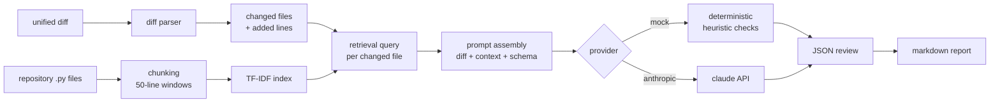

# pr-review-agent

An LLM-powered pull request reviewer that grounds its comments in the
codebase under review. A plain "review this diff" prompt makes a model
guess: it cannot see the callers a change might break, the tests that
already exist for a module, or the conventions of neighbouring code.
This tool retrieves that context first, then asks the model to review
the diff against it.

Every finding is tied to a file and, where it is about a specific line,
to the line number in the new version of the file. Reviews come out as
structured JSON and as a Markdown report grouped into: summary,
potential bugs, missing tests, style and consistency notes, and
questions for the author.

## Quick start

No API key is needed for the demo -- it runs fully offline against a
deterministic mock provider:

```bash
pip install -e .
review-agent --demo --mock
```

Review a real change (any unified diff, e.g. from `git diff` or the
GitHub ".diff" URL of a pull request):

```bash
export ANTHROPIC_API_KEY=...        # only needed without --mock
review-agent --diff change.diff --repo path/to/repo
review-agent --diff change.diff --repo path/to/repo --mock   # offline
review-agent --diff change.diff --repo path/to/repo --out-prefix review
# writes review.md and review.json
```

The bundled demo reviews `samples/sample.diff` (a new `find()` method
added to a tiny task store) against `samples/sample_repo`. The mock
review finds the planted problems in it: a mutable default argument at
`taskstore/store.py:19`, a leftover `print()` at line 20, and no tests
added for the new behaviour.

## How it works



1. **Diff parsing** (`diff_parser.py`) turns unified diff text into
   structured file changes. Added lines carry their line number in the
   new file, which is what findings point at.
2. **Retrieval** (`retriever.py`) chunks every Python file in the repo
   into overlapping 50-line windows and indexes them with TF-IDF
   (scikit-learn). For each changed file, the query is the module name
   plus the added lines; the top chunks from *other* files -- callers,
   related modules, tests -- become the context. The changed file itself
   is excluded: the diff already shows it.
3. **Prompt assembly** (`prompt.py`) combines the diff, the retrieved
   excerpts (each labelled with file and line range), and a strict JSON
   output schema that tells the model to ground findings in what it was
   shown and to prefer a few high-confidence findings.
4. **Providers** (`providers.py`) sit behind one small interface,
   `complete(prompt) -> str`:
   - `AnthropicProvider` calls the Claude API, reading
     `ANTHROPIC_API_KEY` from the environment (never hardcoded).
   - `MockProvider` is deterministic and offline. It runs a small set
     of transparent heuristic checks over the diff (mutable default
     arguments, bare `except:`, `eval()`/`exec()`, leftover `print()`,
     source changes with no test changes, new public functions) and
     emits findings in the same JSON schema. It exists so the pipeline
     can be developed, tested and evaluated without an API key; it is
     not a language model.
5. **Rendering** (`review.py`) parses the JSON reply (tolerating prose
   or code fences around it) and renders the grouped Markdown report.

## Design decisions

- **TF-IDF instead of embeddings.** Retrieval needs no model download,
  no API key and no GPU, and is fully deterministic, which makes the
  evaluation below reproducible. For code, lexical overlap is a strong
  signal anyway: callers and tests share identifiers with the code they
  exercise. The known weakness is semantic similarity with no shared
  identifiers (renamed concepts, paraphrases); an embedding retriever
  behind the same interface is the obvious upgrade.
- **Python keywords are stop words.** `def`, `return`, `import` and
  friends appear in nearly every chunk and matched everything in early
  tests; dropping them measurably improved precision.
- **The changed file is excluded from its own context.** Its changed
  lines are already in the prompt verbatim; spending the context budget
  on *other* files is what makes the review grounded.
- **A provider interface, not a provider.** Swapping the mock for a
  real model (or a local one) touches one class, and the whole pipeline
  -- parsing, retrieval, prompt, rendering -- is testable offline.
- **Structured JSON out, Markdown for humans.** The JSON schema is part
  of the prompt, so findings are machine-checkable (the evaluation
  harness relies on this) and renderers stay trivial.

## Evaluation

`eval/` contains five tiny repositories, each with a diff carrying one
deliberately planted issue: a mutable default argument, a bare
`except:`, a new function with no tests, debug `print()` statements in
auth code, and an `eval()` call. The harness runs the full pipeline in
mock mode and checks, per case, whether retrieval surfaced the context
file a human reviewer would want, and whether the review surfaces the
planted issue in the expected category.

Measured results (`python eval/run_eval.py`):

| case | planted issue | retrieval | issue surfaced | context retrieved |
|---|---|---|---|---|
| mutable-default | mutable default argument | HIT | yes | test_loader.py, validate.py |
| bare-except | bare `except:` | HIT | yes | schema.py, test_parser.py |
| missing-tests | new function, no tests | HIT | yes | cart.py, test_pricing.py |
| debug-print | `print()` in auth code | HIT | yes | session.py, test_auth.py |
| eval-usage | `eval()` on a string | HIT | yes | report.py, test_rules.py |

Retrieval hit rate: **5/5**. Planted issues surfaced: **5/5**.

What this does and does not show, stated plainly:

- It measures the coverage of the retrieval and prompt-assembly stages
  plus the mock provider's deterministic checks -- that the right
  context reaches the prompt and known-bad patterns get flagged.
- It does **not** measure language-model review quality. That would
  need a labelled set of real pull requests and the real provider.
- The case repositories are tiny (three files each), so retrieval has
  few distractors. Treat 5/5 as "the plumbing works", not as evidence
  about performance on a large codebase.

## Tests

```bash
python -m pytest
```

14 tests, all passing. They cover diff parsing (line numbers, test-file
detection, rename-only entries), retrieval (related files surfaced,
changed file excluded, unrelated files not matched), prompt assembly
(diff, context locations and schema present), the mock end-to-end run
on the bundled sample (planted bug found at the right line, determinism
across runs), JSON reply parsing, and that the Anthropic provider
refuses to start without `ANTHROPIC_API_KEY`.

## Limitations

- Retrieval and chunking understand Python files only, and chunking is
  by line windows, not by syntax -- a chunk can split a function.
- The prompt includes whole retrieved chunks; on large repos the
  context budget needs ranking and trimming per file, not a flat top-k.
- The mock provider's heuristics only catch the patterns they encode.
  They are scaffolding for the pipeline, not a review of record.
- Diffs are read from files; there is no GitHub API integration yet, so
  fetching a PR and posting the review back are manual steps.

## Next steps

- Fetch PR diffs and post reviews via the GitHub API (including inline
  comments anchored to diff lines).
- AST-aware chunking (one chunk per function/class) and an optional
  embedding-based retriever behind the same interface.
- A harder evaluation: real open-source PRs with maintainer-confirmed
  issues, scored for the real provider.
- Use the retrieved context to check API-usage claims (e.g. flag a call
  whose signature changed in the same diff).

## Layout

```
src/review_agent/
    diff_parser.py   unified diff -> structured changes with line numbers
    retriever.py     TF-IDF index + per-change retrieval
    prompt.py        diff + context + output schema -> prompt
    providers.py     Anthropic provider and deterministic mock provider
    review.py        pipeline, JSON parsing, markdown rendering
    cli.py           review-agent command line
samples/             bundled demo diff and sample repository
eval/                planted-issue cases and the evaluation harness
tests/               pytest suite
```
